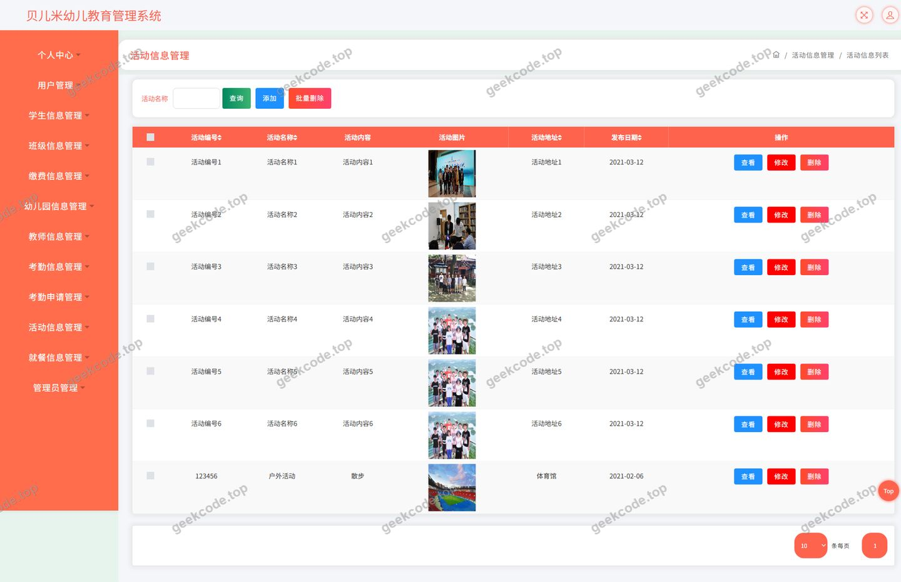
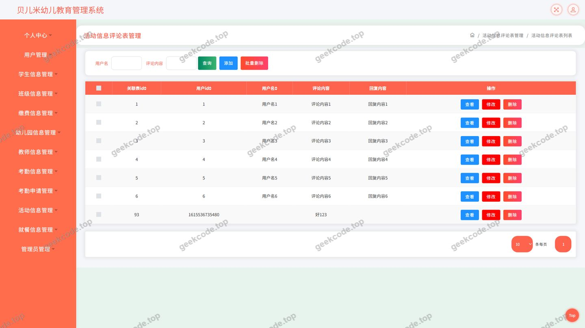
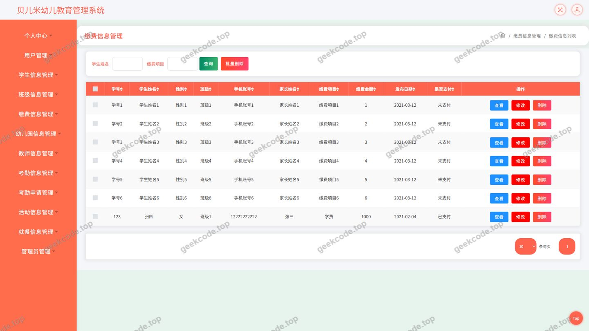
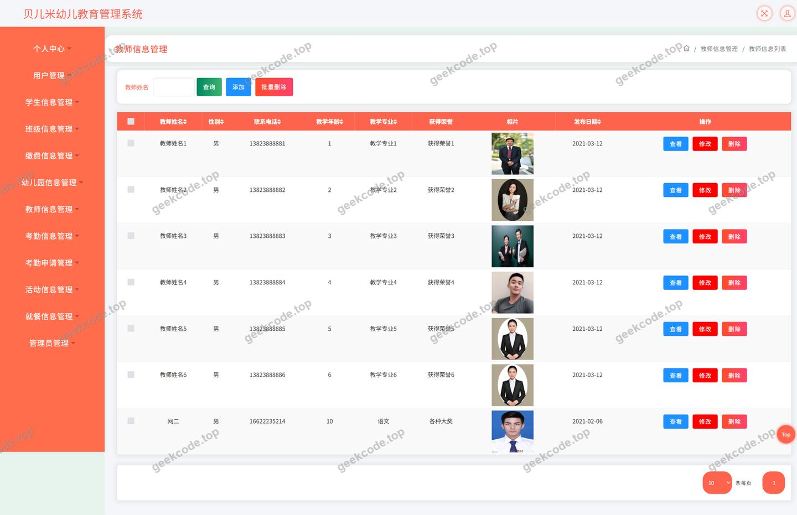
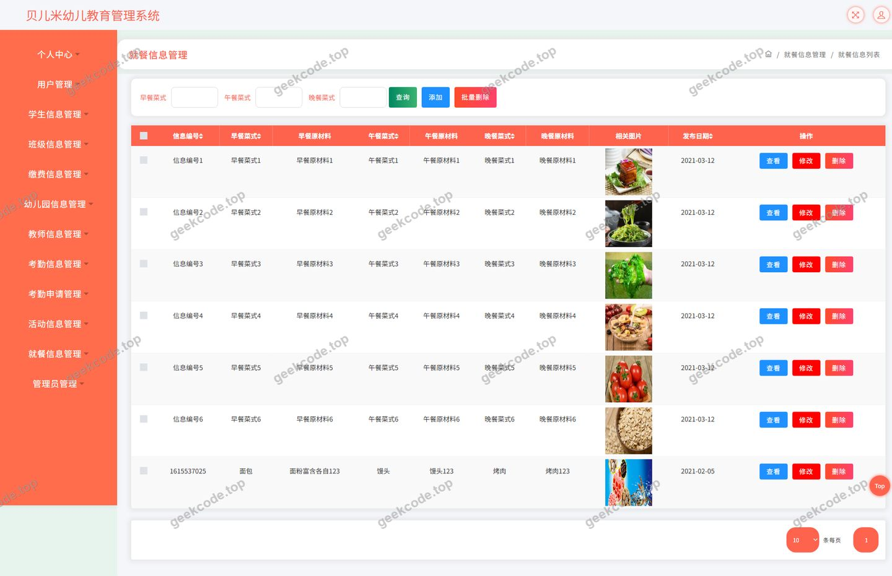
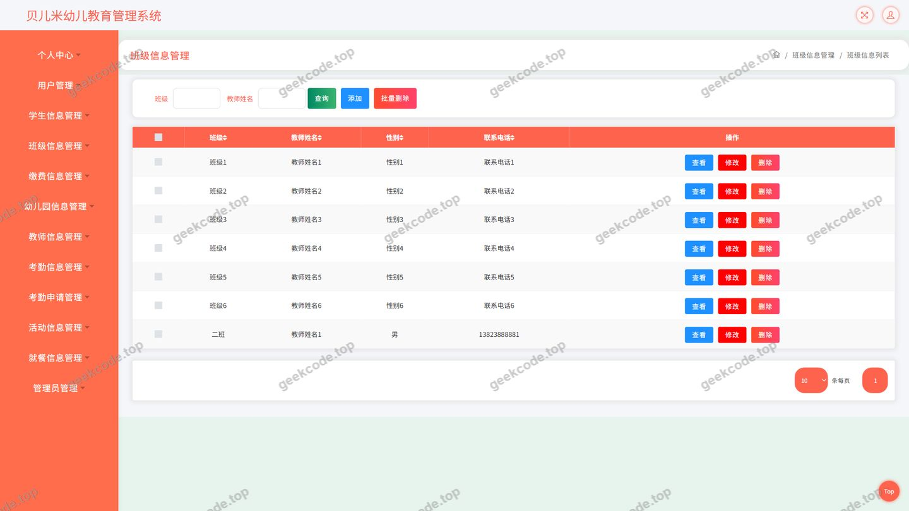

# ssm贝儿米幼儿教育管理系统-java毕业设计

> 🎓 **计算机毕业设计 · ssm贝儿米幼儿教育管理系统-java毕业设计**
>
> 本仓库只放**项目介绍 + 运行截图**（截图是站点带水印的原图，存在仓库 `images/` 里）。
>
> 👉 **完整可运行源码 / 数据库脚本 / 部署文档：[点我获取](https://geekcode.top/archives/ssm%E8%B4%9D%E5%84%BF%E7%B1%B3%E5%B9%BC%E5%84%BF%E6%95%99%E8%82%B2%E7%AE%A1%E7%90%86%E7%B3%BB%E7%BB%9F-java%E6%AF%95%E4%B8%9A%E8%AE%BE%E8%AE%A1?utm_source=github)**
>
> 💬 咨询微信：**ir9372**　|　🌐 更多项目：[极客代码 geekcode.top](https://geekcode.top/?utm_source=github)
>
> 📌 项目详情页：<https://geekcode.top/archives/ssm%E8%B4%9D%E5%84%BF%E7%B1%B3%E5%B9%BC%E5%84%BF%E6%95%99%E8%82%B2%E7%AE%A1%E7%90%86%E7%B3%BB%E7%BB%9F-java%E6%AF%95%E4%B8%9A%E8%AE%BE%E8%AE%A1?utm_source=github>

<table><td width="230" align="center"> <b>扫码加微信 ir9372</b></td><td valign="middle">📦 源码 = 项目介绍 + 全部运行截图 + 数据库 + 部署文档 👉 点上方任意截图，直接跳到 <b>极客代码 geekcode.top</b> 详情页</td></table>

---

<h1>ssm贝儿米幼儿教育管理系统-java毕业设计</h1>
<h2>项目概述</h2>

ssm贝儿米幼儿教育管理系统是一套面向幼儿教育场景的信息化管理后端服务，采用纯接口（pure-api）形态提供数据能力，前端页面通过 HTTP 接口与后端交互。系统围绕幼儿园日常运营中最核心的三类信息展开：幼儿园信息、活动信息与就餐信息，并为这三类信息分别配备了独立的评论能力，便于家长与园方之间就园所介绍、活动安排、每日餐食进行沟通反馈。

在此基础之上，系统还提供缴费信息、教师信息、班级信息与考勤申请等业务数据的管理能力，并配套文件上传与系统配置接口，形成覆盖&quot;园所信息发布—活动组织—餐饮公示—费用缴纳—考勤管理&quot;的完整闭环。用户在登录后可使用个人中心与我的收藏功能，沉淀自己关注的信息。

该系统的适用人群包括幼儿园管理人员、教师以及幼儿家长等需要获取或维护园所信息的使用者。技术架构上，项目基于 Spring + SpringMVC + MyBatis-Plus 的传统分层架构，配合 Druid 数据库连接池完成数据访问，接口结构清晰、部署依赖轻量，适合作为教学与毕业设计场景下的信息化管理系统范例。

<h2>技术架构</h2>
<h3>整体架构</h3>

项目采用经典的三层架构（表现层—业务层—数据访问层），后端以 REST 风格接口对外提供服务，不包含内置的前台或后台页面工程，属于纯接口服务。

<pre><code class="language-mermaid">graph TD
    A[客户端页面] --&gt;|HTTP 请求]| B[表现层 Controller]
    B --&gt; C[业务处理与参数校验]
    C --&gt; D[数据访问层 MyBatis-Plus]
    D --&gt; E[(MySQL 数据库)]
    C --&gt; F[Druid 连接池]
    F --&gt; E
    B --&gt; G[文件存储 FileController]
</code></pre>
<h3>技术选型说明</h3>
<ul>
<li><strong>Spring 体系</strong>：项目依赖 spring-core、spring-beans、spring-context、spring-context-support、spring-aop、spring-tx、spring-jdbc、spring-web、spring-webmvc，构成完整的 IoC 容器、AOP 事务管理与 MVC 请求分发能力，是项目的基础骨架。</li>
<li><strong>MyBatis-Plus</strong>：作为数据访问层框架，在 MyBatis 基础上提供通用 CRUD 能力，减少重复的映射代码编写，提升数据模块的开发效率。</li>
<li><strong>Druid</strong>：作为数据库连接池组件，承担连接复用、连接监控与资源管理职责，保证在高频接口调用下数据库连接的稳定性与可观测性。</li>
<li><strong>JUnit</strong>：用于编写与执行单元测试，验证核心业务逻辑与数据访问的正确性。</li>
</ul>
<h3>接口分层设计</h3>

表现层由 12 个 Controller 组成，各控制器职责边界清晰：

<table>
<thead>
<tr>
<th>控制器</th>
<th>职责</th>
</tr>
</thead>
<tbody><tr>
<td><code>YoueryuanxinxiController</code>（幼儿园信息）</td>
<td>园所基础信息的接口服务</td>
</tr>
<tr>
<td><code>HuodongxinxiController</code>（活动信息）</td>
<td>活动信息的接口服务</td>
</tr>
<tr>
<td><code>JiucanxinxiController</code>（就餐信息）</td>
<td>就餐信息的接口服务</td>
</tr>
<tr>
<td><code>DiscussyoueryuanxinxiController</code></td>
<td>幼儿园信息评论</td>
</tr>
<tr>
<td><code>DiscusshuodongxinxiController</code></td>
<td>活动信息评论</td>
</tr>
<tr>
<td><code>DiscussjiucanxinxiController</code></td>
<td>就餐信息评论</td>
</tr>
<tr>
<td><code>JiaofeixinxiController</code>（缴费信息）</td>
<td>缴费记录与状态维护</td>
</tr>
<tr>
<td><code>JiaoshixinxiController</code>（教师信息）</td>
<td>教师档案信息维护</td>
</tr>
<tr>
<td><code>BanjixinxiController</code>（班级信息）</td>
<td>班级信息维护</td>
</tr>
<tr>
<td><code>KaoqinshenqingController</code>（考勤申请）</td>
<td>考勤申请的提交与处理</td>
</tr>
<tr>
<td><code>FileController</code></td>
<td>文件上传与访问</td>
</tr>
<tr>
<td><code>CommonController</code></td>
<td>通用公共接口</td>
</tr>
<tr>
<td><code>ConfigController</code></td>
<td>系统配置项读取与维护</td>
</tr>
</tbody></table>
<h3>数据库设计要点</h3>
<ul>
<li><strong>核心实体与评论实体分离</strong>：幼儿园信息、活动信息、就餐信息三类业务实体各自对应一张独立的评论表，评论数据与主体数据解耦，既避免单表过宽，也便于按业务维度独立查询与统计。</li>
<li><strong>业务支撑数据独立建表</strong>：缴费信息、教师信息、班级信息、考勤申请分别独立存储，通过关联字段与用户、班级等主体建立联系。</li>
<li><strong>用户维度数据</strong>：用户表承载登录鉴权所需的基础信息，收藏数据以独立映射的形式记录用户与目标信息之间的关注关系，支撑&quot;我的收藏&quot;功能。</li>
<li><strong>配置数据</strong>：由 <code>ConfigController</code> 支撑的系统配置信息集中存储，避免配置硬编码在业务代码中。</li>
</ul>
<h2>功能模块</h2>
<h3>一、前台用户端</h3>
<table>
<thead>
<tr>
<th>模块</th>
<th>功能描述</th>
</tr>
</thead>
<tbody><tr>
<td>登录</td>
<td>提供用户身份认证入口，校验账号信息后进入系统，是访问个人中心、收藏、缴费与考勤申请等功能的前提</td>
</tr>
<tr>
<td>幼儿园信息</td>
<td>浏览园所介绍等基础信息，并可对该信息发表评论</td>
</tr>
<tr>
<td>活动信息</td>
<td>浏览园方组织的各类活动信息，并可对活动内容发表评论</td>
</tr>
<tr>
<td>就餐信息</td>
<td>浏览每日/定期的餐食安排信息，并可对就餐信息发表评论</td>
</tr>
<tr>
<td>缴费信息</td>
<td>查看与自身相关的缴费信息及缴费状态</td>
</tr>
<tr>
<td>教师信息</td>
<td>浏览教师相关档案信息</td>
</tr>
<tr>
<td>考勤申请</td>
<td>提交考勤相关申请，并查看申请记录</td>
</tr>
<tr>
<td>个人中心</td>
<td>维护个人基础资料，管理与查看个人信息</td>
</tr>
<tr>
<td>我的收藏</td>
<td>查看用户收藏的幼儿园信息、活动信息、就餐信息等内容，便于快速回访关注项</td>
</tr>
</tbody></table>
<h3>二、后台管理端</h3>

本项目的管理能力通过接口形式提供，不包含独立的后台页面工程。管理端接口覆盖面如下：

<table>
<thead>
<tr>
<th>模块</th>
<th>功能描述</th>
</tr>
</thead>
<tbody><tr>
<td>幼儿园信息管理</td>
<td>对园所基础信息进行新增、修改、查询、删除等维护操作</td>
</tr>
<tr>
<td>活动信息管理</td>
<td>发布与维护活动信息，管理活动的完整生命周期数据</td>
</tr>
<tr>
<td>就餐信息管理</td>
<td>维护就餐安排信息，支撑餐饮信息的公示与更新</td>
</tr>
<tr>
<td>幼儿园信息评论管理</td>
<td>对园所信息下的评论数据进行查询与管理</td>
</tr>
<tr>
<td>活动信息评论管理</td>
<td>对活动信息下的评论数据进行查询与管理</td>
</tr>
<tr>
<td>就餐信息评论管理</td>
<td>对就餐信息下的评论数据进行查询与管理</td>
</tr>
<tr>
<td>缴费信息管理</td>
<td>维护缴费记录、缴费金额与缴费状态等信息</td>
</tr>
<tr>
<td>教师信息管理</td>
<td>维护教师档案信息</td>
</tr>
<tr>
<td>班级信息管理</td>
<td>维护班级基础信息</td>
</tr>
<tr>
<td>考勤申请管理</td>
<td>查看与处理用户提交的考勤申请</td>
</tr>
<tr>
<td>文件管理</td>
<td>处理图片、附件等文件的上传与访问，为各业务模块提供素材支撑</td>
</tr>
<tr>
<td>系统配置管理</td>
<td>读取与维护系统级配置参数</td>
</tr>
<tr>
<td>通用接口</td>
<td>提供跨模块的公共数据服务，供各业务模块复用</td>
</tr>
</tbody></table>
<h2>用户角色与权限</h2>

系统基于登录功能区分使用者的身份，在现有信息范围内可划分出以下角色：

<h3>管理员</h3>

管理员负责系统内全部业务数据的维护，可访问的功能模块包括：

<ul>
<li>幼儿园信息管理：新增、修改、删除、查询园所信息</li>
<li>活动信息管理：发布、编辑、下架活动信息</li>
<li>就餐信息管理：维护每日餐食安排</li>
<li>幼儿园信息评论管理：查看与处理园所信息下的评论</li>
<li>活动信息评论管理：查看与处理活动信息下的评论</li>
<li>就餐信息评论管理：查看与处理就餐信息下的评论</li>
<li>缴费信息管理：登记、修改缴费记录与状态</li>
<li>教师信息管理：维护教师档案</li>
<li>班级信息管理：维护班级数据</li>
<li>考勤申请管理：审核与处理考勤申请</li>
<li>文件管理：上传与维护业务所需的文件资源</li>
<li>系统配置管理：维护系统级配置参数</li>
</ul>
<h3>普通用户</h3>

普通用户以信息获取与自助服务为主，可访问的功能模块包括：

<ul>
<li>登录：完成身份认证</li>
<li>幼儿园信息：浏览园所信息并发表评论</li>
<li>活动信息：浏览活动信息并发表评论</li>
<li>就餐信息：浏览就餐信息并发表评论</li>
<li>教师信息：浏览教师信息</li>
<li>缴费信息：查看自身缴费信息</li>
<li>考勤申请：提交考勤申请并查看处理情况</li>
<li>个人中心：维护个人资料</li>
<li>我的收藏：收藏与查看关注的信息内容</li>
</ul>

教师信息在本项目中以业务数据模块的形式存在，由管理员统一维护。教师或其他身份是否具备独立登录入口与差异化权限，根据现有信息无法确定。

<h2>项目特色与创新点</h2>
<ol>
<li>
<strong>主题聚焦幼儿教育场景</strong>：不同于泛化的通用管理系统，本项目围绕幼儿园实际运营中的信息类型组织功能，幼儿园信息、活动信息、就餐信息三条主线直接对应家长最关心的园所介绍、活动安排与餐食公示需求。

</li>
<li>
<strong>核心信息均配备评论能力</strong>：三类核心信息各自拥有独立的评论模块，评论与主体数据在接口层与数据层均保持解耦，使信息不只是单向发布，而具备了双向沟通属性，提升了系统的实用性。

</li>
<li>
<strong>业务链路完整</strong>：从信息发布（园所、活动、就餐）、费用管理（缴费信息）、人员管理（教师、班级）到流程审批（考勤申请），覆盖了园所日常管理的主要环节，形成闭环而非零散的功能堆砌。

</li>
<li>
<strong>纯接口架构，前后端解耦</strong>：项目以 pure-api 形式提供后端服务，接口职责单一、边界清晰，前端技术栈可自由选型，便于后续扩展为 Web 端、移动端等多种载体。

</li>
<li>
<strong>分层清晰，便于维护与教学</strong>：控制器按业务实体一一对应，命名直观，配合 MyBatis-Plus 的通用 CRUD 与 Druid 连接池的监控能力，代码结构规范，适合作为学习与二次开发的基础。

</li>
</ol>
<h2>部署环境</h2>
<h3>后端运行环境</h3>
<table>
<thead>
<tr>
<th>项目</th>
<th>要求</th>
</tr>
</thead>
<tbody><tr>
<td>JDK</td>
<td>Java 8 及以上（Spring 4/5 体系均基于 Java 8 特性构建）</td>
</tr>
<tr>
<td>构建工具</td>
<td>Maven，用于依赖管理与项目构建</td>
</tr>
<tr>
<td>数据库</td>
<td>MySQL，需预先创建数据库并导入初始化脚本</td>
</tr>
<tr>
<td>数据库连接池</td>
<td>Druid，随项目依赖引入，通过配置文件配置连接参数</td>
</tr>
<tr>
<td>Web 容器</td>
<td>由于项目基于 spring-webmvc 构建且不包含内嵌容器依赖，需部署至外置 Servlet 容器（如 Tomcat）运行</td>
</tr>
<tr>
<td>单元测试</td>
<td>JUnit，随项目依赖引入</td>
</tr>
</tbody></table>
<h3>客户端环境</h3>

项目本身不含前台与后台页面工程，客户端为独立的页面应用，通过 HTTP 协议调用后端接口。若需完整运行系统，需另行部署对应的前端页面工程。

<h3>环境说明</h3>

本项目为 Java 后端接口服务，未使用 Node.js 相关技术栈，也未涉及微信小程序开发，因此无需安装 Node.js 或微信开发者工具。

<h2>五、技术特性</h2>
<ul>
<li>使用 MyBatis-Plus 简化数据访问层开发</li>
</ul>
<h2>六、功能模块截图</h2>
<h3>后台管理端</h3>
<h4>页面-登录</h4>

<h4>页面-活动信息</h4>

<h4>页面-活动信息评论</h4>

<h4>页面-缴费信息</h4>

<h4>页面-教师信息</h4>

<h4>页面-就餐信息</h4>

<h4>页面-就餐信息评论</h4>

<h4>页面-用户</h4>

<h4>页面-幼儿园信息评论</h4>

---

## 获取完整源码

| 项目 | 说明 |
| --- | --- |
| 项目名 | ssm贝儿米幼儿教育管理系统-java毕业设计 |
| 运行截图 | 本文 9 张（站点带水印原图，仓库 `images/` 目录） |
| 完整源码 | [https://geekcode.top/archives/ssm%E8%B4%9D%E5%84%BF%E7%B1%B3%E5%B9%BC%E5%84%BF%E6%95%99%E8%82%B2%E7%AE%A1%E7%90%86%E7%B3%BB%E7%BB%9F-java%E6%AF%95%E4%B8%9A%E8%AE%BE%E8%AE%A1?utm_source=github](https://geekcode.top/archives/ssm%E8%B4%9D%E5%84%BF%E7%B1%B3%E5%B9%BC%E5%84%BF%E6%95%99%E8%82%B2%E7%AE%A1%E7%90%86%E7%B3%BB%E7%BB%9F-java%E6%AF%95%E4%B8%9A%E8%AE%BE%E8%AE%A1?utm_source=github) |
| 咨询微信 | **ir9372**（备注：jingpin-yuanma） |
| 更多项目 | [极客代码 geekcode.top](https://geekcode.top/?utm_source=github) |

> 需要源码、部署、改配置、跑不起来等问题，加微信 ir9372 沟通，说明项目名即可。
